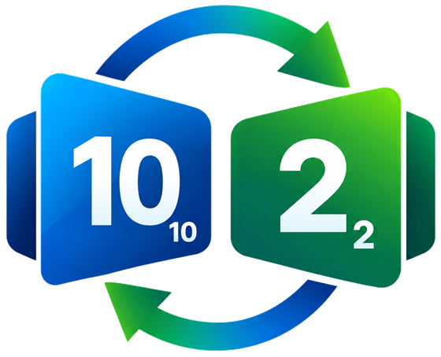

<div align="center">



# BitSeen — Your Number System Bestie & CS Study Guide

> *"Tiny bits, big numbers — you've got this, bestie!"*

[](https://developer.mozilla.org/en-US/docs/Web/HTML)
[](https://developer.mozilla.org/en-US/docs/Web/CSS)
[](https://developer.mozilla.org/en-US/docs/Web/JavaScript)
[](#icon-system)
[](#how-to-run)
[](#student-goods--study-features)
[](#license)

**A cute, highly interactive number system converter and study companion built to make Computer Science fundamentals fun, tactile, and stress-free.**

</div>

---

##  Table of Contents

- [Twilight Beach Sunset Color Palette](#twilight-beach-sunset-color-palette)
- [App Architecture](#app-architecture)
- [Student Goods & Study Features](#student-goods--study-features)
  - [1. Live Base Converter (Home Page)](#1-live-base-converter-home-page)
  - [2. 8-Bit Register Playground (Visual Bit Flipper)](#2-8-bit-register-playground-visual-bit-flipper)
  - [3. Student Exam Cheat Sheet & CS Hacks](#3-student-exam-cheat-sheet--cs-hacks)
  - [4. ASCII Character Lab](#4-ascii-character-lab)
  - [5. Switchy Companion](#5-switchy-companion)
- [Icon System](#icon-system)
- [How to Run](#how-to-run)
- [Project Structure](#project-structure)
- [Why Students Love BitSeen](#why-students-love-bitseen)
- [License](#license)

---

##  Twilight Beach Sunset Color Palette

BitSeen features a soothing, modern color palette inspired by an evening twilight sunset over the ocean:

| Swatch | Color | Hex | Role |
| :---: | :--- | :--- | :--- |
|  | **Night Charcoal** | `#18181B` | High-contrast text & dark mode depth |
|  | **Deep Oceanic Teal** | `#0E5B6A` | Primary interactive accents & binary base |
|  | **Dusk Plum / Violet** | `#573F5A` | Secondary headers & decimal base |
|  | **Muted Mauve Slate** | `#81697E` | Step-by-step borders, octal base, & badges |
|  | **Twilight Sunset Rose** | `#B7687C` | Highlights, buttons, streak badges, & hex base |
|  | **Soft Dawn Blush Pink** | `#F4C7CB` | Light mode tint, speech bubbles, & mascot blush |

> [!NOTE]
> These are the exact light-mode values from `css/style.css` (`:root` custom properties). Dark mode re-tunes every one of them for contrast.

---

##  App Architecture

BitSeen is a **focused four-page study system**. The landing page is deliberately trimmed to just the **Live Base Converter**, with every other tool reachable from the top navigation bar and **all trivia delivered by Switchy**.

| Path | Page | Description |
| :--- | :--- | :--- |
| `index.html` | **Live Base Converter** | The home page: instant, as-you-type conversion across Bases 2–36 with a "Show me how BitSeen did it" step breakdown, toast notifications, and trivia spoken by Switchy (on each conversion and automatically every 10 seconds). |
| `register.html` | **8-Bit Register Playground** | Interactive visual bit-flipper ($b_7$ to $b_0$), High/Low nibbles, signed two's complement sign-bit, and live formula sum. |
| `cheatsheet.html` | **Exam Cheat Sheet & CS Hacks** | Segmented-tab reference: searchable Powers of 2 lookup ($2^0$ to $2^{16}$) with 1-click copy, an 8-column nibble decoder grid, and 4 legendary exam shortcuts. |
| `ascii.html` | **ASCII Character Lab** | 7-bit ASCII decimal-to-character interactive laboratory with quick high-yield example chips. |

> [!TIP]
> **Cross-page superpower:** every page links back into the converter. Flip bits in the register playground, hit **Send to Converter**, and land on `index.html` with the full step-by-step math already loaded.

---

##  Student Goods & Study Features

### 1.  Live Base Converter (Home Page)

- **Instant Conversion**  — Converts as you type across Bases 2, 8, 10, and 16 from the quick-pick dropdown, with a dedicated result pane. (The engine underneath handles *any* base from 2 to 36.)
- **Step Breakdown**  — Hit *"Show me how BitSeen did it"* to see the full equation, the per-digit weighting, and the repeated-division table.
- **Toast Notifications**  — Every conversion, invalid digit, hint and achievement is reported in a colour-coded toast notification at the top centre of the screen — no inline status lines anywhere. Repeated feedback reuses the same toast instead of stacking duplicates.
- **Switchy Trivia**  — Every 10 seconds Switchy pops up a **trivia fact**, a **study tip** or a **cheer** — no hovering required. Switchy reveals themselves for each message and the bubble is replaced in place. They wait for you to pause typing so their bubble never flickers mid-conversion.
- **Base Palette**  — The toast accents and colours shift to match the base you are working in.

<details>
<summary><strong>What does "Bases 2–36" mean?</strong></summary>

The dropdown presets are the four you'll actually use in class — Binary (2), Octal (8), Decimal (10), and Hexadecimal (16). Under the hood, `js/converter.js` validates any base between **2 and 36** and maps digits `0–9` plus `A–Z` onto values `0–35`, so Base 32 or Base 36 conversions are perfectly legal.

</details>

### 2.  8-Bit Register Playground (Visual Bit Flipper)

- **Unified Bit Strip**  — All 8 toggles ($b_7$ down to $b_0$) sit in one compact panel, split by a hairline into **High Nibble** (Bits 7–4) and **Low Nibble** (Bits 3–0) so you intuitively understand how hexadecimal digits map to binary. On phones the strip reflows into two tappable rows of 4.
- **Live Equation Builder**  — Displays the exact summation formula in real-time (e.g. $128 + 32 + 8 + 1 = 169$).
- **Single Readout Panel**  — One hairline-separated strip shows Unsigned Decimal ($0–255$), Signed Two's Complement ($-128$ to $+127$, with a sign badge), Hexadecimal (`0x00`–`0xFF`, with the high/low nibble split), Octal, and ASCII preview.
- **Icon-Only Action Rail**  — Clear, Set All, Invert (`~NOT`), Shift Left, Shift Right, Random, and **Send to Converter** — compact 38px buttons so the panel stays quiet.
- **Cross-Page Redirection**  — Click **"Send to Converter"** to push your custom register byte to `index.html` with full step-by-step math!
- **Rotating Concept Cards**  — The **"How Computer Registers Work"** guide shows **one card at a time** and auto-advances every 7 seconds, so the page never dumps every concept on you at once. Prev/next arrows and clickable dots sit under the card, and a **pause/resume toggle lives beside the "CS Theory" badge** in the section header. It pauses while you hover, focus a control, or switch tabs, and respects `prefers-reduced-motion`.

### 3.  Student Exam Cheat Sheet & CS Hacks

- **Segmented Section Tabs**  — One compact pill control switches between **Powers of 2**, **Hex Nibbles**, and **Exam Hacks** — no page reload, no clutter.
- **Powers of 2 Table ($2^0$ to $2^{16}$)**  — Searchable reference table with decimal values, hex equivalents, and real-world CS memory usage (1 Byte, 1 KiB, 4 KiB OS page, 64 KiB port range).
- **1-Click Copy**  — Tap the **Common CS Usage** chip in any row to copy that usage note to your clipboard (then just hit <kbd>Ctrl</kbd>+<kbd>C</kbd> / <kbd>⌘</kbd>+<kbd>C</kbd> to paste), so the table needs no extra column or icon.
- **4-Bit Hex Nibble Grid**  — A tight 2×8 decoder grid connecting binary `0000`–`1111` to hex `0`–`F`; click a tile to copy its binary.
- **Professor BitSeen's Exam Shortcuts**  — One numbered list panel, four shortcuts.
  - *The 4-Bit Chunking Trick*: Convert binary to hex in seconds without division.
  - *The Two's Complement 3-Second Rule*: Keep bits from the right up to the first `1`, invert the rest!
  - *Instant Even/Odd Rule*: Check the least significant bit ($2^0$).
  - *Prefix Guide*: `0b` (binary), `0o` (octal), `0x` (hex).

<details>
<summary><strong>Deep dive: the 4-bit chunking trick</strong></summary>

Split the binary string into groups of four from the right, then read each group as one hex digit:

```text
1011 0110  →  B    6   →  0xB6  →  182
```

No division, no long division table — just eyeball the four-bit blocks.

</details>

<details>
<summary><strong>Deep dive: the two's complement 3-second rule</strong></summary>

To negate an 8-bit number: keep every bit from the right up to and including the first `1`, then invert everything to the left of it.

```text
0000 0101  (5)   → keep 0101, invert 0000 → 1111 1011  (0xFB = −5)
```

Check: $256 - 5 = 251 = \texttt{0xFB}$ — the two's complement of 5 is -5.

</details>

### 4.  ASCII Character Lab

- **Two-Way Decoder**  — Type a decimal code point (0–127) or type a character — BitSeen resolves the other side instantly.
- **Bit-Level Readouts**  — Every character shows its 8-bit binary form and its hexadecimal form side by side.
- **Control Character Names**  — The full 0–127 table with friendly names (NUL, SOH, LF, CR, DEL, …).
- **Quick High-Yield Examples**  — One-click chips for `A = 65`, `a = 97`, `0 = 48`, `Space = 32`, and `! = 33`.

### 5.  Switchy Companion

Switchy is the **only voice of the app** — all trivia, study tips and cheers are spoken by them, never by a separate panel.

- The Binary Conversion Exchange mascot: a binary card and a decimal card swapping values through two curved arrows, docked in the **bottom-right corner** of every page, floating gently and **giggling every time it speaks**.
- **Every 10 Seconds**  — Switchy speaks up **on their own, with no trigger at all**. The beat cycles through three kinds of message, each with its own bubble icon:
  - **Trivia**  — a computing-history fact, weighted to appear most often.
  - **Study tip**  — a practical exam trick: flip it both ways, build a place-value chart, memorise the nibble table, or drill for 10 minutes a day.
  - **Cheer**  — a bit of encouragement, because studying should feel good.
- **Matched to your conversion**  — type a number and Switchy answers with a fact tied to the base you are working in (why a byte is 8 bits, why a hex digit is exactly one nibble, why octal divides cleanly by 3, and more).
- **Never interrupted**  — a greeting already on screen is never cut short, and the tick is skipped while the tab is in the background.
- Use the little pill button under them to minimize them or bring them back for distraction-free focus; a cheer greets you when they return.
- Even while minimized the 10-second beat keeps running — the message simply arrives as a toast, so **no fact is ever lost**.

> [!IMPORTANT]
> If you'd rather study in silence, minimize them once and they go quiet — **no fact is ever lost**, the 10-second beat simply arrives as a toast instead.

---

##  Icon System

Every emoji has been replaced with a hand-picked **inline SVG icon set** (`js/icons.js`):

- **Zero dependencies**: no icon font, no CDN, no network request — the sprite is inlined at runtime.
- **Theme aware**: every icon inherits `currentColor`, so it re-tints automatically in light and dark mode.
- **Crisp at any size**: vector paths scale perfectly from a 16px table button to a 40px section heading.
- **Accessible**: icons are marked `aria-hidden="true"` and always sit next to real text labels.

The icons in this README are the **same artwork**. `tools/generate-readme-icons.js` reads `js/icons.js` and emits one standalone SVG per icon into `assets/icons/`, so the README can never drift from the app:

```bash
node tools/generate-readme-icons.js
```

Each generated file carries its own theme awareness: presentation attributes provide the light-mode Twilight Beach colour, and an embedded `prefers-color-scheme` block swaps in the dark-mode tint.

---

##  How to Run

BitSeen is 100% static client-side web technology — no installation, no node dependencies, no backend, and completely private (works offline):

1. Clone or download this repository.

   ```bash
   git clone https://github.com/haidemabido01/cs312-number-system-converter.git
   cd cs312-number-system-converter
   ```

2. Open `index.html` in any modern web browser.
3. Use the navigation bar at the top to move between the **Converter**, **8-Bit Register**, **Cheat Sheet**, and **ASCII Lab**!

> [!NOTE]
> There is no build step and no `npm install`. Clone, double-click `index.html`, done — the app never touches the network. (The optional `tools/` script only regenerates README icons.)

---

##  Project Structure

```text
/ (repository root)
├── index.html          # Live Base Converter (home page)
├── register.html       # 8-Bit Visual Register Playground
├── cheatsheet.html     # Student Exam Cheat Sheet & CS Hacks
├── ascii.html          # 7-Bit ASCII Character Lab
├── 404.html            # Friendly not-found page (links back into the app)
├── netlify.toml        # Netlify build config, pretty URLs & cache headers
├── assets/
│   ├── binary-conversion-exchange.png # Binary Conversion Exchange icon (transparent)
│   ├── favicon.png                    # Square exchange mark — app avatar & browser-tab favicon
│   └── icons/                         # Standalone SVG icons used by this README
├── css/
│   └── style.css       # Twilight Sunset palette, SVG icon system & responsive design
├── js/
│   ├── icons.js        # Inline SVG icon sprite & helper
│   ├── feedback.js     # Toast notification engine
│   ├── app.js          # Core wiring, base conversions, ASCII decoding, & theme
│   ├── converter.js    # Pure mathematical conversion & step explanation engine
│   ├── student.js      # 8-Bit Register, Exam Cheat Sheet & rotating concept carousel
│   └── trivia.js       # Trivia engine + Switchy companion (the only voice of the app)
└── tools/
    └── generate-readme-icons.js # Regenerates assets/icons/ from js/icons.js
```

<details>
<summary><strong>Where should I start reading?</strong></summary>

| If you're studying… | Read this first |
| :--- | :--- |
| Number bases & conversions | `js/converter.js`  `js/app.js` |
| Bit patterns & two's complement | `js/student.js`  `register.html` |
| ASCII & encoding | `js/app.js` (ASCII decoder)  `ascii.html` |
| The mascot & trivia content | `js/trivia.js` (engine + Switchy widget) |
| Visual design & theming | `css/style.css`  `js/icons.js` |

</details>

---

##  Why Students Love BitSeen

- **Focused by Design**  — The home page does two things brilliantly — convert and teach — with no duplicated tool listings.
- **Zero Judgment**  — Made a typo? BitSeen explains exactly what went wrong without any penalty.
- **Visual Intuition**  — Turn abstract binary formulas into interactive buttons you can click and experiment with.
- **Dark Mode Included**  — Easy on tired eyes during late-night study sessions.
- **Completely Private**  — Everything runs locally in your browser — no tracking, no ads, no sign-ups.

---

##  License

MIT License. Built with love for students everywhere.

> *Tiny bits, big numbers.*
